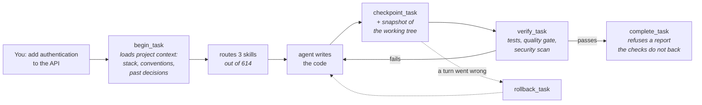
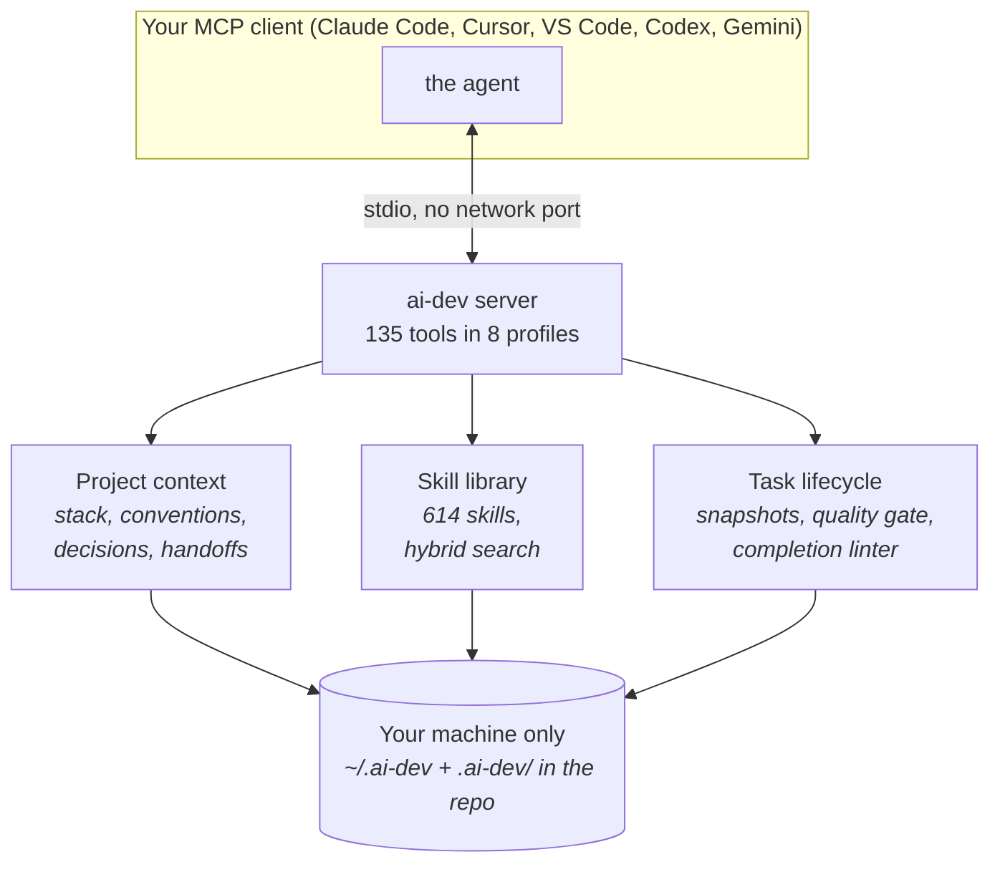

# AI Dev System

> 🇬🇧 English (this page) · 🇷🇺 Русская версия: [README.ru.md](README.ru.md)

**A local layer for AI coding agents: durable memory of your project, the skills a
task actually needs, a controlled task lifecycle, and a completion the agent has
to prove.**

It runs on your machine over `stdio` — no network port, no remote server, no
account. You point an MCP client you already use (Claude Code, Claude Desktop,
Cursor, VS Code, Codex, Gemini) at it, and the agent in that client gains the
four things below.

---

## The problem

A coding agent is capable and forgetful. Every session it:

- **starts from zero** — it has no memory of your architecture, your conventions,
  or the decision you made last week, so you re-explain the project each time;
- **guesses its approach**, because nothing routes it from "add authentication"
  to the knowledge that applies to authentication;
- **works without a shape** — no explicit start, no checkpoints, no way back when
  a turn goes wrong;
- **and then tells you it is finished.** *"Should work."* *"Pre-existing issue."*
  *"Skipping tests for now."*

The last one is the expensive one. A finished task and a confident sentence look
identical, and you find out which you got later.

## What happens after you install it

One task, start to finish. This is the whole product:



Four things the agent could not do before:

| | |
| --- | --- |
| 🧠 **It remembers the project** | `begin_task` compiles a context pack: the stack, the conventions, the architectural decisions on record, the handoff from the last session, and the instincts learned across sessions. You stop re-explaining. |
| 🎯 **It finds the knowledge that applies** | Hybrid search (keyword + sparse + optional local BGE-M3) routes the request to at most three skills out of 614 — enough to be useful, few enough to stay in context. |
| 🔒 **It works inside a lifecycle** | Begin, checkpoint, verify, complete. Every checkpoint snapshots the working tree, so any turn can be undone without touching your branch, stash or index. |
| ✅ **It cannot just say it is done** | `complete_task` lints the completion report against the checks that actually ran. "Should work", "pre-existing issue", "skipping tests for now" come back refused, with the rule and what is missing. |

**→ [Watch it run on a real task](docs/DEMO.md)** — "add authentication to the API",
scene by scene, including the verification failure and the fix.

## Install

Three ways, one system — pick by what you have:

| | |
| --- | --- |
| **Windows, no terminal** | Download `AI-Dev-Setup-<version>.exe` from the project's releases and run it. No administrator, no Node, Python or Docker: the desktop app brings its own Node, and its first-run wizard connects your AI clients and sets up the local model ([The Windows install](docs/DESKTOP.md#the-windows-install)). |
| **One command, with Node** — macOS, Linux, Windows | `npx @stonebridgeway/ai-dev-system setup` — Node.js 22.16+ (or 24+), and nothing else. |
| **Docker** — the server in a container | `sh ./bootstrap.sh` on macOS and Linux, `bootstrap.ps1` on Windows, with Docker running; on Windows also Node.js 22.12+ and a clone of the repository, since Node writes the clients' configs. For a machine that should not hold a personal vault, or a team that wants one image everybody runs the same way. |

```bash
npx @stonebridgeway/ai-dev-system setup
```

`setup` installs its own copy into `~/.ai-dev`, asks whether to connect the AI clients it
finds — Claude Code, Claude Desktop, Cursor, VS Code, Codex and Gemini CLI — and whether to
fetch the local search model (`--yes` takes the defaults: clients yes, model no), builds the
search index, and connects the clients. Each client gets one entry, `ai-dev`, that starts your
Node by its full path, so a client opened from the Dock or the Start menu finds it too. Every
other server in those files stays as it was, each file is backed up before it changes, an
`ai-dev-system` entry from 2.x is replaced, and running it again changes nothing. Restart the
clients afterwards; that is the whole install.

Search, hybrid ranking, the knowledge galaxy and project preparation all run in Node. Python is
optional: two tools — `query_ui_ux_knowledge` and `generate_ui_ux_design_system`, over the UI
UX Pro Max dataset — run a Python script, and without Python they say so. The local dense model
is one flag, `setup --model`: a pinned, checksum-verified ONNX export of BGE-M3, run in Node; a
broken download continues where it stopped, and `AI_DEV_MODEL_MIRROR` and `HTTPS_PROXY` are
honoured. In Docker, one `docker run … ai-dev model install` puts it in the data volume.

Until 3.0 is published, build from a clone what is not out yet: the Windows installer
(`cd desktop && npm ci && npm run dist:win` leaves `AI-Dev-Setup-<version>.exe` in the clone's
`dist/windows/installer/`; outside Windows it needs Wine — [Building it](docs/DESKTOP.md#building-it)),
the npm package ([npx](docs/INSTALL.md#one-command-with-node-npx)), and the image, whose `:latest`
tag is still a 2.x image that bootstrap cannot install 3.0 from ([Docker](docs/INSTALL.md#docker)).

Every client's configuration block, the Docker details, the local model, updating from 2.x,
uninstalling, and what to do when it does not work: **[docs/INSTALL.md](docs/INSTALL.md)**.
Working on AI Dev itself, from a clone: [CONTRIBUTING.md](CONTRIBUTING.md).

## Your first task

Open a repository in your client and say:

```text
Use the ai-dev MCP server. Begin a task for ~/Dev/my-project:
add CSV export for the report, cover the change with tests, and run verify_task.
```

With Docker the server sees only the projects folder bootstrap mounted — `AI-Dev-Projects` in your
home, unless `--project-path` (`-ProjectPath` on Windows) or the entries bootstrap replaced named another —
so keep the project there.
On macOS and Linux the server sees it at its own path; on Windows it sees the folder as
`/workspace`: name the project `/workspace/my-project`.

What you should see: the agent calls `begin_task`, reports the context it
compiled and the skills it routed, writes the code, checkpoints, runs
`verify_task`, and only then closes the task — with a pull request description
written from the evidence into `.ai-dev/pr/<task_id>.md`. In a repository AI Dev
has not seen before, it first runs `prepare_project`, which writes `AGENTS.md`
and the checks `verify_task` runs, `.ai-dev/quality-gate.md`, from the
project's own scripts.

If it tries to close early, it will not be allowed to. That is the point.

## What you get

The server exposes 135 tools to an agent (and 13 more, the [control API](ai-dev-mcp-server/docs/CONTROL-API.md), to an app that asks for them). You do not need to know them — they are grouped
into eight **capability profiles**, and only `core` is on the critical path:

| Profile | Tools | What it adds |
| --- | --- | --- |
| **`core`** | 25 | Project context, skill routing, and a task from first command to verified completion. *Always on.* |
| `coding` | 18 | Epics, the plan gate, project cards, and the repository's own engineering rules. |
| `memory` | 17 | Decisions, session handoffs, instincts learned across sessions, and a 3D galaxy of the vault to fly through. |
| `git` | 9 | Isolated worktrees, snapshots and rollback, diff review, pull request text. |
| `frontend` | 13 | Brief, visual directions, design system, references. |
| `qa` | 8 | Playwright and visual QA, and the benchmarks that hold search and routing honest. |
| `security` | 9 | Secret and dependency scans, dependency fix plans, command and write policy, MCP inventory. |
| `advanced` | 36 | Diagrams, the search and skill indexes, the dashboard, usage, packaging. |

Set `AI_DEV_PROFILES=core,git` and the server advertises 34 tools instead of 135
— about 33 KB of `tools/list` schema for the client instead of 139 KB, before
the model has read a word of your request (measured; the command is in
[Capabilities](docs/CAPABILITIES.md#what-narrowing-actually-costs-and-saves)). Unset, everything is on and nothing is hidden —
unless profiles were chosen in the settings (`profiles` in `~/.ai-dev/config.json`, which the
desktop app writes): they fill an unset `AI_DEV_PROFILES` for every `ai-dev` command.

**[docs/CAPABILITIES.md](docs/CAPABILITIES.md)** — what each profile carries and
when to turn it on.

## How it works



Everything is local and readable: project state lives in `.ai-dev/` inside the
repository (reviewable in a pull request), personal memory in `~/.ai-dev/`. The
Docker image carries no vault, tokens, projects, or task history, and the
container runs with no network, no capabilities, and a read-only root filesystem.

## Documentation

| | |
| --- | --- |
| [**Demo**](docs/DEMO.md) | One real task end to end, including the failure and the fix. |
| [**Install**](docs/INSTALL.md) | The three ways to install, every client, the local model, uninstalling, diagnostics. |
| [**Moving from 2.x**](docs/MIGRATION.md) | What 3.0 changes for a 2.x install, what moves by itself, and the way back. |
| [**Desktop app**](docs/DESKTOP.md) | The tray, the first-run wizard and the Status screen. |
| [**Workflow**](docs/WORKFLOW.md) | The task lifecycle, epics, undoing a turn, memory and learning. |
| [**Capabilities**](docs/CAPABILITIES.md) | The eight profiles and how to narrow the tool surface. |
| [**Knowledge Galaxy**](docs/GALAXY.md) | The vault as a 3D galaxy to fly through, in place of Obsidian's graph view. |
| [**Guard rails**](docs/GUARDRAILS.md) | Agent hooks, policy rules, MCP inventory, local data and security. |
| [**Tool reference**](ai-dev-mcp-server/docs/TOOLS.md) | All 148 tools — the 135 an agent sees and the 13 of the control API — generated from the server itself. |
| [**Control API**](ai-dev-mcp-server/docs/CONTROL-API.md) | The tools an app drives the install with, and the answers they promise. |
| [**Architecture**](ai-dev-mcp-server/docs/ARCHITECTURE.md) | How the server is put together. |
| [**Changelog**](CHANGELOG.md) | What changed, and what to re-check after upgrading. |

## Contributing

See [CONTRIBUTING.md](CONTRIBUTING.md) for the development workflow, how the test
suite is split between a standalone checkout and a full vault, and the checks CI
runs. Working through an AI agent? [AGENTS.md](AGENTS.md) holds the rules an
agent gets wrong on this repository.

Participation is governed by the [Code of Conduct](CODE_OF_CONDUCT.md).
Security reports: [SECURITY.md](SECURITY.md).

## Licences

This project is MIT — see [LICENSE](LICENSE).

The bundled skill catalogue is imported work, not written here. Every source is
MIT, ships its licence text beside its own files under
`docker/public-seed/03-skills-catalog/sources/`, and is recorded in
[THIRD_PARTY_NOTICES.md](THIRD_PARTY_NOTICES.md) with the revision that was
imported: [Membrane application-skills](https://github.com/membranedev/application-skills)
(460 of its 3,074 connectors — the developer tools and AI models, see
[CURATION.md](docker/public-seed/03-skills-catalog/sources/external/membrane/CURATION.md)), [ECC — Everything Claude Code](THIRD_PARTY_NOTICES.md) (101),
[Understand Anything](https://github.com/Egonex-AI/Understand-Anything) (9),
[mattpocock/skills](https://github.com/mattpocock/skills) (1), and the
[taste-skill](https://github.com/Leonxlnx/taste-skill), [ui-ux-pro-max](https://github.com/nextlevelbuilder/ui-ux-pro-max-skill) and [Archify](https://github.com/tt-a1i/archify) design and diagram tooling.
