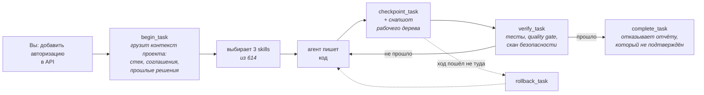
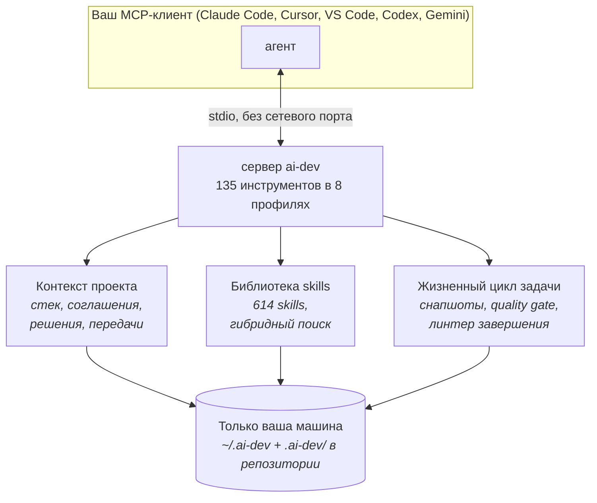

# AI Dev System

> 🇷🇺 Русский (эта страница) · 🇬🇧 English version: [README.md](README.md)

**Локальный слой для AI coding agents: постоянная память о проекте, нужные для
задачи skills, контролируемый жизненный цикл работы и завершение, которое агент
обязан доказать.**

Работает на вашей машине по `stdio` — без сетевого порта, без удалённого сервера,
без аккаунта. Вы направляете на него MCP-клиент, которым и так пользуетесь
(Claude Code, Claude Desktop, Cursor, VS Code, Codex, Gemini), и агент в этом
клиенте получает четыре вещи, описанные ниже.

---

## Проблема

Coding-агент способный и беспамятный. В каждой сессии он:

- **начинает с нуля** — не помнит вашу архитектуру, ваши соглашения и решение,
  принятое на прошлой неделе, поэтому проект приходится объяснять заново;
- **угадывает подход**, потому что ничто не ведёт его от «добавить авторизацию»
  к знаниям, которые к авторизации относятся;
- **работает без формы** — нет явного начала, нет чекпоинтов, нет пути назад,
  когда ход пошёл не туда;
- **и сообщает, что закончил.** *«Должно работать».* *«Это pre-existing issue».*
  *«Тесты пока пропустим».*

Дорого обходится последнее. Сделанная задача и уверенная фраза выглядят
одинаково, а что из этого вам досталось — выясняется позже.

## Что происходит после установки

Одна задача от начала до конца. Это и есть весь продукт:



Четыре вещи, которых агент раньше не умел:

| | |
| --- | --- |
| 🧠 **Он помнит проект** | `begin_task` компилирует пакет контекста: стек, соглашения, записанные архитектурные решения, передачу из прошлой сессии и инстинкты, накопленные между сессиями. Объяснять заново не нужно. |
| 🎯 **Он находит подходящие знания** | Гибридный поиск (ключевые слова + sparse + опциональная локальная BGE-M3) направляет запрос максимум к трём skills из 614 — достаточно, чтобы помочь, и мало, чтобы уместиться в контекст. |
| 🔒 **Он работает внутри жизненного цикла** | Начать, зачекпоинтить, проверить, завершить. Каждый чекпоинт снимает снапшот рабочего дерева, поэтому любой ход можно отменить, не трогая ветку, stash и индекс. |
| ✅ **Он не может просто заявить, что закончил** | `complete_task` сверяет отчёт с проверками, которые действительно выполнялись. «Должно работать», «pre-existing issue», «тесты пока пропустим» возвращаются отказом с названием правила и тем, чего не хватает. |

**→ [Посмотреть на настоящей задаче](docs/ru/DEMO.md)** — «добавить авторизацию в
API», по шагам, включая падение проверки и исправление.

## Установка

Три способа, одна система — выбирайте по тому, что у вас есть:

| | |
| --- | --- |
| **Настольное приложение** — Windows, Linux, без терминала | Скачайте пакет для своей системы из релизов проекта: `AI-Dev-Setup-<версия>.exe` или AppImage / `.deb`. Без Node, Python и Docker: приложение несёт свой Node; его мастер подключает ваших AI-клиентов и ставит локальную модель, а экраны меняют всё остальное — настройки, ваши навыки, правила репозитория, MCP-серверы, которые он запускает ([Установка приложения](docs/ru/DESKTOP.md#установка-приложения)). |
| **Сервер для ИИ-агентов, из терминала** — Linux, Windows | `npx ai-dev-system setup` — Node.js 22.16+ (или 24+), и больше ничего. Потом `ai-dev` без аргументов открывает меню над всеми настройками, а `ai-dev settings`, `skills`, `rules`, `servers`, `status` делают то же из скрипта, и по SSH тоже ([Настройка сервера из терминала](docs/ru/INSTALL.md#настройка-сервера-из-терминала)). |
| **Docker** — сервер в контейнере | `sh ./bootstrap.sh` на Linux, `bootstrap.ps1` на Windows, при запущенном Docker; на Windows ещё нужны Node.js 22.12+ и клон репозитория — конфиги клиентов пишет Node. Для машины, на которой не должно быть личного vault, или для команды, которой нужен один образ на всех. |

**macOS в разработке.** Его код есть в репозитории, и CI гоняет его тесты на Mac, но в релизе 3.0
приложения для Mac нет, а установка из терминала и через Docker на Mac не поддерживается, пока её
там не примут ([Выпуск 3.0](docs/ru/RELEASE.md#что-выходит)).

```bash
npx ai-dev-system setup
```

`setup` ставит свою копию в `~/.ai-dev`, спрашивает, подключить ли найденных AI-клиентов — Claude
Code, Claude Desktop, Cursor, VS Code, Codex и Gemini CLI — и скачать ли локальную модель поиска
(`--yes` берёт ответы по умолчанию: клиенты — да, модель — нет), строит поисковый индекс и
подключает клиентов. Каждый клиент получает одну запись, `ai-dev`, которая запускает ваш Node по
полному пути, поэтому её находит и клиент, открытый из Dock или меню «Пуск». Остальные серверы в
этих файлах остаются как были, перед изменением каждый файл сохраняется в резервную копию, запись
`ai-dev-system` из 2.x заменяется, а повторный запуск ничего не меняет. После этого перезапустите
клиентов — это вся установка.

Поиск, гибридное ранжирование, галактика знаний и подготовка проекта работают в Node. Python не
обязателен: скрипт на Python запускают два инструмента — `query_ui_ux_knowledge` и
`generate_ui_ux_design_system`, работающие с набором UI UX Pro Max, — и без Python они так и
отвечают. Локальная dense-модель — один флаг, `setup --model`: пиннутый ONNX-экспорт BGE-M3 со
сверкой sha256, работающий в Node; оборванная загрузка продолжается с места обрыва, а
`AI_DEV_MODEL_MIRROR` и `HTTPS_PROXY` учитываются. В Docker модель кладёт в том данных один
`docker run … ai-dev model install`.

Пока 3.0 не опубликован, то, чего ещё нет, собирают из клона: настольное приложение
(`cd desktop && npm ci && npm run dist:win` — или `dist:linux` на Linux — кладёт
пакеты в `dist/` клона; установщику Windows вне Windows нужен Wine — [Сборка](docs/ru/DESKTOP.md#сборка)),
пакет npm ([npx](docs/ru/INSTALL.md#одна-команда-с-node-npx)) и образ, чей тег `:latest` — ещё образ
2.x, с которого bootstrap не поставит 3.0 ([Docker](docs/ru/INSTALL.md#docker)).

Блоки конфигурации для каждого клиента, подробности Docker, локальная модель, обновление с 2.x,
удаление и что делать, если не заработало: **[docs/ru/INSTALL.md](docs/ru/INSTALL.md)**. Работа
над самим AI Dev, из клона: [CONTRIBUTING.md](CONTRIBUTING.md) *(на английском)*.

## Первая задача

Откройте репозиторий в клиенте и скажите:

```text
Используй MCP-сервер ai-dev. Начни задачу для ~/Dev/my-project:
добавь экспорт отчёта в CSV, покрой изменение тестами и выполни verify_task.
```

С Docker сервер видит только папку проектов, которую смонтировал bootstrap, — `AI-Dev-Projects` в
домашней папке, если `--project-path` (`-ProjectPath` на Windows) или записи, которые bootstrap
заменил, не назвали другую, — поэтому
держите проект там. На Linux сервер видит его по своему пути; на Windows он видит эту папку
как `/workspace`: называйте проект `/workspace/my-project`.

Что вы должны увидеть: агент вызывает `begin_task`, показывает собранный контекст
и выбранные skills, пишет код, ставит чекпоинт, запускает `verify_task` и только
после этого закрывает задачу — с описанием pull request, собранным из
доказательств в `.ai-dev/pr/<task_id>.md`. В репозитории, которого AI Dev ещё не
видел, он сначала вызывает `prepare_project`: тот пишет `AGENTS.md` и проверки,
которые запускает `verify_task`, — `.ai-dev/quality-gate.md` — из скриптов
самого проекта.

Если он попробует закрыть её раньше, ему не дадут. В этом и смысл.

## Что вы получаете

Агенту сервер отдаёт 135 инструментов (и ещё 16 — [control API](ai-dev-mcp-server/docs/CONTROL-API.md) — приложению, которое их попросит). Знать их не нужно — они собраны в восемь
**профилей возможностей**, и на критическом пути только `core`:

| Профиль | Инструментов | Что добавляет |
| --- | --- | --- |
| **`core`** | 25 | Контекст проекта, маршрутизацию skills и задачу от первой команды до подтверждённого завершения. *Всегда включён.* |
| `coding` | 18 | Эпики, plan gate, карточки проекта и инженерные правила репозитория. |
| `memory` | 17 | Решения, передачи между сессиями, инстинкты, накопленные со временем, и 3D-галактика хранилища, по которой можно летать. |
| `git` | 9 | Изолированные worktree, снапшоты и откат, разбор диффа, текст pull request. |
| `frontend` | 13 | Бриф, визуальные направления, дизайн-систему, референсы. |
| `qa` | 8 | Playwright и визуальный QA, а также бенчмарки поиска и маршрутизации. |
| `security` | 9 | Сканы секретов и зависимостей, планы исправления зависимостей, политику команд и записи, инвентаризацию MCP. |
| `advanced` | 36 | Диаграммы, индексы поиска и skills, дашборд, расходы, упаковку runtime. |

Задайте `AI_DEV_PROFILES=core,git` — и сервер объявит 34 инструмента вместо 135:
около 33 КБ схемы `tools/list` для клиента вместо 139 КБ (замерено, команда —
в [Возможностях](docs/ru/CAPABILITIES.md#сколько-это-экономит)), ещё до того как модель прочитала
ваш запрос. Если переменная не задана, включено всё и ничего не скрыто — если только профили не
выбраны в настройках (`profiles` в `~/.ai-dev/config.json`, их пишет настольное приложение): они
заполняют незаданную `AI_DEV_PROFILES` для каждой команды `ai-dev`.

**[docs/ru/CAPABILITIES.md](docs/ru/CAPABILITIES.md)** — что несёт каждый профиль
и когда его включать.

## Как это устроено



Всё локально и читаемо: состояние проекта лежит в `.ai-dev/` внутри репозитория
(его видно в pull request), личная память — в `~/.ai-dev/`. В Docker-образе нет
ни vault, ни токенов, ни проектов, ни истории задач, а контейнер работает без
сети, без capabilities и с файловой системой только для чтения.

## Документация

| | |
| --- | --- |
| [**Демо**](docs/ru/DEMO.md) | Одна настоящая задача целиком, включая падение и исправление. |
| [**Установка**](docs/ru/INSTALL.md) | Три способа установки, все клиенты, локальная модель, удаление, диагностика. |
| [**Переход с 2.x**](docs/ru/MIGRATION.md) | Что 3.0 меняет для установки 2.x, что переносится само и как вернуться. |
| [**Настольное приложение**](docs/ru/DESKTOP.md) | Трей, мастер первого запуска и экран «Статус». |
| [**Рабочий процесс**](docs/ru/WORKFLOW.md) | Жизненный цикл задачи, эпики, отмена хода, память и обучение. |
| [**Возможности**](docs/ru/CAPABILITIES.md) | Восемь профилей и как сузить набор инструментов. |
| [**Галактика знаний**](docs/ru/GALAXY.md) | Хранилище как 3D-галактика, по которой можно летать, — вместо графа Obsidian. |
| [**Ограничители**](docs/ru/GUARDRAILS.md) | Хуки агента, правила политики, инвентаризация MCP, локальные данные и безопасность. |
| [**Справочник инструментов**](ai-dev-mcp-server/docs/TOOLS.md) | Все 151 инструмент — 135, которые видит агент, и 16 control API, — сгенерировано из самого сервера. *(на английском)* |
| [**Control API**](ai-dev-mcp-server/docs/CONTROL-API.md) | Инструменты, которыми приложение управляет установкой, и ответы, которые они обещают. *(на английском)* |
| [**Архитектура**](ai-dev-mcp-server/docs/ARCHITECTURE.md) | Как устроен сервер. *(на английском)* |
| [**История изменений**](CHANGELOG.md) | Что изменилось и что перепроверить после обновления. |

## Участие в разработке

[CONTRIBUTING.md](CONTRIBUTING.md) — рабочий процесс, как разделён набор тестов
между отдельным клоном и полным vault, и какие проверки запускает CI. Работаете
через ИИ-агента? В [AGENTS.md](AGENTS.md) собраны правила, которые агент на этом
репозитории понимает неверно. Участие регулируется
[Кодексом поведения](CODE_OF_CONDUCT.md). Сообщения об уязвимостях:
[SECURITY.md](SECURITY.md).

## Лицензии

AI Dev — © 2026 stonebridgeway, с 3.0 по лицензии [PolyForm Noncommercial License 1.0.0](LICENSE):
бесплатно для личного использования, учёбы, исследований, хобби-проектов и некоммерческих организаций,
изменять код можно; любое коммерческое использование — на работе, в продукте или сервисе компании —
только по коммерческой лицензии от автора: [Telegram @stonebridgeway](https://t.me/stonebridgeway). 2.x и более ранние версии вышли под MIT и под ней
остаются.

Встроенный каталог skills — заимствованная работа, а не написанная здесь. Каждый
источник под MIT, текст лицензии лежит рядом с его файлами в
`docker/public-seed/03-skills-catalog/sources/`, и каждый записан в
[THIRD_PARTY_NOTICES.md](THIRD_PARTY_NOTICES.md) с импортированной ревизией:
[Membrane application-skills](https://github.com/membranedev/application-skills)
(460 из 3 074 коннекторов — инструменты разработки и модели ИИ, см.
[CURATION.md](docker/public-seed/03-skills-catalog/sources/external/membrane/CURATION.md)), [ECC — Everything Claude Code](THIRD_PARTY_NOTICES.md) (101),
[Understand Anything](https://github.com/Egonex-AI/Understand-Anything) (9),
[mattpocock/skills](https://github.com/mattpocock/skills) (1), а также
[taste-skill](https://github.com/Leonxlnx/taste-skill), [ui-ux-pro-max](https://github.com/nextlevelbuilder/ui-ux-pro-max-skill) и [Archify](https://github.com/tt-a1i/archify) — инструменты дизайна и диаграмм.
